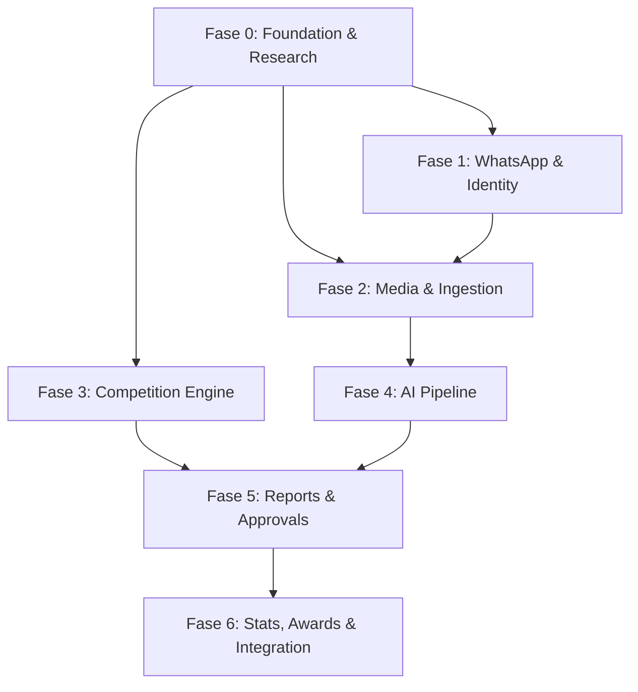

# Flash Peak TMS — Rencana Kerja Bertahap

**Versi:** 1.1
**Tanggal:** 18 November 2026
**Basis dokumen:** `flash-peak-tms/` v0.1.1-draft (14 file + MANIFEST.json)
**Status:** Menunggu persetujuan organizer sebelum eksekusi

---

## Hasil Audit

### Repository Status
- **Kode:** Belum ada sama sekali (greenfield). Hanya folder `flash-peak-tms/` berisi dokumentasi.
- **Git:** Belum diinisialisasi.
- **Existing tools:** Node.js v24.14.1, npm 11.11.0, Python 3.11.15 tersedia.

### Referensi Verax (D:\Projects\verax)
- ✅ **Ada** di lokal. Struktur media service terverifikasi di `services/media-storage/`:
  - Standalone HTTP server (Node.js, `node:http`) — ringan, tanpa framework
  - Storage tree: `public/`, `private/`, `quarantine/`, `tmp/`, `backups/`, `database/`
  - Metadata DB: SQLite (`database/media.sqlite`) via `node:sqlite` (DatabaseSync)
  - Auth: HMAC signature per-request dengan nonce replay protection
  - PM2 config: port `4188`, storage root `/var/lib/verax/media`, `--max-old-space-size=96`, max memory restart `150M`
  - Sangat ringan — cocok untuk VM kecil (2 vCPU, ~1GB RAM)
- **Pattern yang akan direplikasi** (instance TERPISAH — BUKAN reuse Verax): folder layout, metadata-sidecar SQLite, HMAC auth, visibility separation, quarantine flow
- **TIDAK di-share:** port, path, DB file, PM2 service name — semua terpisah untuk Flash Peak (D-021, D-022, O-011)

### VM (Belum Diverifikasi Live)
- Historis: Azure `forfh-korea-vm`, Ubuntu 24.04.5, Standard_B2ats_v2 (~2 vCPU, ~1 GiB RAM)
- **Harus diverifikasi ulang sebelum deployment** — data di atas adalah observasi historis, bukan live health check
- **Catatan tambahan:** VM yang sama ini kemungkinan juga menjalankan layanan untuk project lain (ForFH web, Verax). Saat Fase 6.9 (deployment), cek beban/kapasitas aktual sebelum menambahkan proses baru — jangan asumsikan seluruh ~1GB RAM tersedia untuk Flash Peak saja.

### Key Constraints
- Database: Turso/libSQL (cloud, TLS remote)
- AI Providers: Groq + Gemini + Ollama Cloud (free tier, load-balanced/rotated — D-010/O-010)
- WhatsApp: Baileys (perlu research v7 vs v6 dulu — mandatory gate)

---

## Pembagian Fase (Berdasarkan SWARM_PLAN.md §4)

### Fase 0 — Foundation & Research

**Tujuan:** Setup project, riset Baileys, proposal domain model, database schema

| # | Task | Deskripsi | Output |
|---|------|-----------|--------|
| 0.1 | **Git init & project skeleton** | Init repo, tsconfig, package.json, eslint, .gitignore, .env.example, folder structure `src/`, `tests/`, `docs/`, `migrations/`, `services/` | Project skeleton |
| 0.2 | **Baileys research** | Clone repo ke `vendor/baileys-reference/` (shallow, catat commit SHA + tag). **Verifikasi versi TERKINI secara live saat eksekusi (via `npm view @whiskeysockets/baileys versions`, halaman GitHub Releases, dan `baileys.wiki`) — JANGAN percaya nomor versi yang tercatat di dokumentasi lama (mis. catatan "v7.0.0-rc14" di draft sebelumnya sudah usang dan tidak boleh dijadikan rujukan; rc number pada library ini berubah cepat, kadang dalam hitungan hari).** Periksa v7 (masih release candidate, breaking changes besar — baca `https://whiskey.so/migrate-latest`) vs v6 stable, migration guide, npm tags, TypeScript types, JID/LID handling. Tulis `docs/BAILEYS_RESEARCH.md` sesuai AGENT.md §2, cantumkan tanggal verifikasi dan versi persis yang dipilih beserta alasannya. | Research doc |
| 0.3 | **Domain model & shared types** | Definisikan TypeScript types/interfaces untuk seluruh entity di DATA_MODEL.md. Zod schemas untuk validasi. **Termasuk field `left_side_team_id` (FK, assigned at fixture-generation time per FR-COMP-013) dan `host_assignment_reason` (enum: `DEFAULT_LEFT_SIDE`, `OPPONENT_SUBSTITUTED`, `ORGANIZER_OVERRIDE`) di tabel `fixtures`** — ini terpisah dari `host_team_id` yang merekam siapa yang benar-benar host. | `src/shared/types/`, `src/shared/schemas/` |
| 0.4 | **Database schema & migrations** | Buat migration awal berdasarkan DATA_MODEL.md menggunakan `@libsql/client` + evaluasi Drizzle ORM compatibility. Schema harus mencakup semua 20+ entity termasuk `left_side_team_id` dan `host_assignment_reason` di fixtures. | `migrations/001_initial.sql` |

**Dependencies:** Tidak ada — ini adalah fondasi.

---

### Fase 1 — WhatsApp Adapter & Identity (Agent 1 + Agent 2)

**Tujuan:** Koneksi WhatsApp berjalan, identitas delegate terikat

| # | Task | Deskripsi | Output |
|---|------|-----------|--------|
| 1.1 | **Baileys connection lifecycle** | Socket management, auth state persistence (di luar business tables — AGENT.md §4), reconnect, event listener setup | `src/whatsapp/connection.ts` |
| 1.2 | **Inbound event normalization** | Normalize WhatsApp events ke internal event format. Capture: message key, chat ID, sender JID/LID, participant, text, caption, media type/metadata/reference, reply context (reply_to_key), timestamp (message + received) | `src/whatsapp/normalizer.ts` |
| 1.3 | **Outbound messaging** | Send text, send with quote/reply, send progressive reveal messages (untuk draw) | `src/whatsapp/sender.ts` |
| 1.4 | **Identity resolver** | Map observed JID/LID/phone ke canonical `delegate_id`. Alias storage dengan provenance. Duplicate detection (jangan buat delegate kedua untuk orang yang sama dari linked device). Ambiguity → organizer review. | `src/identity/resolver.ts` |
| 1.5 | **Command router** | Parse `!command` messages, authorization checks (organizer vs delegate vs unknown), group scope validation (FR-ID-005) | `src/whatsapp/router.ts` |
| 1.6 | **`!onboarding` service** | Sequential team-by-team verification, reply binding to bot prompt (FR-ON-004), delegate association, completion checks, idempotency (FR-ON-006), multiple divisions as separate teams (FR-ON-007) | `src/identity/onboarding.ts` |

**Tests:** JID/LID alias tests, onboarding state machine, duplicate delegate prevention, linked-device scenario, unauthorized sender rejection

---

### Fase 2 — Media Service & Ingestion (Agent 4)

**Tujuan:** Evidence images tersimpan aman, debounce berjalan

| # | Task | Deskripsi | Output |
|---|------|-----------|--------|
| 2.1 | **Flash Peak media service** | Instance TERPISAH mengikuti pattern Verax. **Bukan reuse — port, path, PM2 name, SQLite DB semua baru.** Storage tree: `private/match_evidence/`, `private/goalkeeper_detail/`, `private/supporting/`, `private/manual_review/`, `quarantine/`, `tmp/`, `backups/`, `database/`. Media roles: `MAIN_MATCH`, `GOALKEEPER_DETAIL`, `SUPPORTING_EVIDENCE`, `MANUAL_REVIEW`. Evidence private by default (INFRASTRUCTURE.md §4). HMAC auth. | `services/flashpeak-media/` |
| 2.2 | **Media client adapter** | Upload/download/verify dari bot ke media service. SHA-256 verification, metadata storage di Turso (`media_assets` table). Path dari service, bukan user/model input (ARCHITECTURE.md §10). | `src/media/client.ts` |
| 2.3 | **Message ingestion pipeline** | Capture inbound messages, normalize, deduplicate by stable `provider_message_key` (FR-ING-006), persist ke `inbound_messages` table | `src/ingestion/capture.ts` |
| 2.4 | **Report session management** | Create/attach report sessions per fixture/team/game context. Late evidence attaches to existing open session, bukan buat baru (FR-ING-007). Session expiry dengan extension cap 3x (FR-ING-008/D-033). | `src/ingestion/session.ts` |
| 2.5 | **Five-second debounce** | Per-session sliding window (FR-ING-002/003 — BUKAN global timer). Durable state di DB (FR-ING-004). Atomic batch close dengan lease/claim (FR-ING-005). Restart-safe. Team A message tidak reset Team B session. | `src/ingestion/debounce.ts` |

**Tests:** Debounce timing (fake clock), dedup, restart persistence, concurrent sessions isolation, late evidence attachment, session expiry + 3x extension cap

---

### Fase 3 — Competition Engine (Agent 3)

**Tujuan:** Draw, fixtures, standings, series logic berjalan

| # | Task | Deskripsi | Output |
|---|------|-----------|--------|
| 3.1 | **Tournament configuration** | CRUD tournament, group config validation, format settings (GROUP + KNOCKOUT only — D-008) | `src/competition/tournament.ts` |
| 3.2 | **`!draw` service** | Crypto-secure Fisher-Yates shuffle (FR-COMP-003). **Group sizing dihitung programatically dari jumlah tim aktual** (FR-COMP-010): ukuran grup HANYA boleh 5 atau 4, tidak pernah <4 atau >5. Algoritma: hitung berapa grup-5 dan berapa grup-4 yang diperlukan agar total = jumlah tim, bukan "grup terakhir nampung sisa". Contoh: 23 tim → 3×5 + 2×4 = 23 ✓; 17 tim → 1×5 + 3×4 = 17 ✓. Backend harus menghitung ini untuk setiap jumlah tim arbitrer — jangan hardcode contoh. **Edge case jumlah tim kecil: kombinasi grup-5/grup-4 hanya valid untuk total ≥ 8 (minimal 2 grup, karena 4+4=8 adalah kombinasi valid terkecil). Untuk total tim < 8, sistem TIDAK BOLEH memaksakan pembagian grup yang tidak valid — tolak `!draw` dengan pesan jelas ke organizer ("jumlah tim belum cukup untuk membentuk minimal 2 grup, minimal 8 tim") dan minta organizer menunggu pendaftaran lebih lanjut atau menentukan format alternatif secara manual. Jangan membuat 1 grup tunggal sebagai fallback diam-diam — itu mengubah format kompetisi tanpa sepengetahuan organizer.** Persist-before-reveal (FR-COMP-004), progressive reveal satu tim per pesan (FR-COMP-005), resume-on-restart tanpa reroll (FR-COMP-006), audit trail lengkap (FR-COMP-007). Qualifiers: fixed 2 per grup regardless of size (FR-COMP-011). | `src/competition/draw.ts` |
| 3.3 | **Fixture generation** | Round-robin single (FR-COMP-012) dengan **balanced left/right side assignment** menggunakan circle method atau algoritma round-robin standar (FR-COMP-013/D-034). Setiap tim left-count vs right-count berbeda maks 1 di fixtures grupnya. `left_side_team_id` di-generate sekali di fixture-generation time, disimpan di record, tidak berubah saat retry/reprocessing. Knockout bracket generation dengan left/right assignment per fixture untuk host-default. | `src/competition/fixtures.ts` |
| 3.4 | **Standings calculator** | Points (W3/D1/L0), GD, GF, head-to-head (points → GD → GF), playoff/organizer — computed dari locked games only (FR-CALC-007). | `src/competition/standings.ts` |
| 3.5 | **BO3/BO5 series logic** | Series tracking, game-within-series. Tied individual KO game di-replay; replay result masuk ke slot `game_number` yang sama (FR-CALC-004/005/D-028) — tied game TIDAK consume numbered slot sendiri. BO3 first-to-2, BO5 first-to-3. No drawn series. | `src/competition/series.ts` |
| 3.6 | **Walkover & room-card handling** | **PENTING — dua konsep berbeda yang TIDAK BOLEH tercampur di kode:** (1) **Genuine in-game draw** = pertandingan benar-benar dimainkan dan skor imbang → 1 poin masing-masing (FR-CALC-001, COMPETITION_RULES §3.1). (2) **Double room-card unavailable / double walkover** = tidak ada tim yang bisa menyediakan room card, pertandingan TIDAK dimainkan → Group Stage: 0 poin masing-masing, TIDAK ada player statistics (D-031/FR-FIX-006). KO: WAJIB reschedule, bukan walkover/draw (D-032). Harus ada field/status yang membedakan keduanya secara eksplisit (misalnya `is_walkover`, `walkover_type`). Juga: single walkover (satu tim forfeit) → WO 3-0 (Group), 0-2/0-3 series loss (KO). Host forfeit logic (FR-FIX-005/D-029). | `src/competition/walkover.ts` |

**Tests:** Group sizing untuk BANYAK jumlah tim (8, 9, 13, 17, 20, 23, 24, 25 — TESTING.md §8), **termasuk kasus tim < 8 → draw ditolak dengan pesan jelas, bukan fallback diam-diam**, draw no-reroll on restart, side balance assertion (left vs right diff ≤ 1), series tied-replay slot reuse, **eksplisit test bahwa double WO → 0 poin ≠ genuine draw → 1 poin**, KO double-unavailable → reschedule bukan walkover

---

### Fase 4 — AI Pipeline (Agent 5)

**Tujuan:** Screenshot extraction dan correction parsing berjalan

| # | Task | Deskripsi | Output |
|---|------|-----------|--------|
| 4.1 | **Provider adapter interface** | Abstract interface: capabilities declaration (text, image, multi-image, JSON/schema output), health check, timeout, bounded retry, quota tracking, latency recording (AI_PIPELINE.md §8). Jangan expose API keys ke prompts/logs. | `src/ai/adapter.ts` |
| 4.2 | **Groq adapter** | Implement untuk Groq free tier. Verify image input + structured output support untuk model aktual. | `src/ai/providers/groq.ts` |
| 4.3 | **Gemini adapter** | Implement untuk Gemini free tier. Verify vision + structured output capability. | `src/ai/providers/gemini.ts` |
| 4.4 | **Ollama Cloud adapter** | Implement untuk Ollama Cloud free tier. Verify model capabilities. | `src/ai/providers/ollama.ts` |
| 4.5 | **Provider router** | Load-balanced/rotated selection across 3 providers (D-010/O-010), fallback chain, circuit breaker, quota check. Jika semua gagal → manual mode (FR-FAIL-002). Stop retry on invalid credentials/quota exhaustion/policy errors (AI_PIPELINE.md §8). | `src/ai/router.ts` |
| 4.6 | **Image classifier** | `MAIN_MATCH_SUMMARY` / `INDIVIDUAL_PLAYER_DETAIL` / `UNKNOWN_OR_UNRELATED` / `UNREADABLE` — from prompt catalog §3. Jangan infer category dari caption saja. | `src/ai/classifier.ts` |
| 4.7 | **Main match extractor** | Score, player rows, nicknames (preserve raw Unicode), per-player stats — from prompt catalog §4. Return null for unreadable, never invent. | `src/ai/extractors/match.ts` |
| 4.8 | **Goalkeeper detail extractor** | Visual cue detection (cap, gloves, ball), summary metrics extraction, `defense_raw` preserved, `goalkeeper_saves = defense_raw` only after classification + player linking (FR-GK-003). Hidden tabs = null not zero (AI_PIPELINE.md §4). | `src/ai/extractors/goalkeeper.ts` |
| 4.9 | **Goalkeeper identity resolver** | **Metode: Caption-based fuzzy match against submitting team's roster SAJA (AI_PIPELINE.md §5, FR-GK-005, D-030).** Tim identitas sudah fixed dari submission policy (hanya winning team yang submit). Caption fuzzy-match hanya untuk resolve WHICH goalkeeper di roster tim tersebut. **⛔ DILARANG KERAS fallback ke statistical vector matching (membandingkan rating/goals/assists/passes/defense antar screenshot) — pendekatan ini sudah DITOLAK secara eksplisit karena goalkeeper stat vectors cluster terlalu ketat (kebanyakan 0 gol/0 assist) untuk disambiguasi reliabel. Jika caption tidak resolve ke unique goalkeeper → `AMBIGUOUS`/`UNMATCHED` → minta manual confirmation dari delegate, JANGAN coba cross-match.** | `src/ai/extractors/gk-identity.ts` |
| 4.10 | **Correction parser** | NL correction → structured patch — from prompt catalog §6. Resolve team → player ordinal → metric → old/new value. Indonesian terms mapping (gol→goals, asis→assists, umpan→passes, defense→defense). `NEEDS_CLARIFICATION` jika ambiguous. | `src/ai/correction-parser.ts` |
| 4.11 | **Prompt catalog** | Versioned prompt templates with Zod output schemas. Setiap prompt: `prompt_id`, `version`, `task`, `input_contract`, `output_schema`, `abstention_conditions`, `evaluation_cases` (PROMPT_CATALOG.md §2). | `src/ai/prompts/` |

**Tests:** Mock provider responses untuk semua error types (TESTING.md §10), classification accuracy, extraction schema validity, correction parsing (termasuk contoh "player urutan 3"), **eksplisit test: goalkeeper identity TIDAK pernah menggunakan stat vector matching** (TESTING.md §9)

---

### Fase 5 — Report, Approval & Manual Mode (Agent 6)

**Tujuan:** Full report lifecycle berjalan

| # | Task | Deskripsi | Output |
|---|------|-----------|--------|
| 5.1 | **Report versioning** | Create draft from extraction, immutable versions, correction → new version (FR-COR-006/007). Report context persisted (FR-COR-001) — jangan rely pada LLM chat memory. | `src/reports/versioning.ts` |
| 5.2 | **Backend validation** | Score consistency, player count per side, roster membership, numeric ranges non-negative, fixture context, duplicate player/row detection (AI_PIPELINE.md §6 backend checks). Jangan trust LLM-supplied totals — hitung di backend (ARCHITECTURE.md §8). | `src/reports/validation.ts` |
| 5.3 | **Correction orchestration** | Receive correction → parse via AI → validate sender authority (FR-COR-006) → validate target report/version/team/player/metric/value → stage patch → show proposed correction → on confirmation → create new version → reset all approvals (FR-APR-003) | `src/reports/corrections.ts` |
| 5.4 | **Three-party approval** | Team A delegate + Team B delegate + Organizer (FR-APR-001). Tied to immutable version ID (FR-APR-002). Any correction resets all approvals (FR-APR-003). All three approve same version → `LOCKED`. Only organizer may lock/reopen/override with reason + audit (FR-APR-004). | `src/reports/approval.ts` |
| 5.5 | **`!manualreport` command** | Admin-only (FR-FAIL-003). Manual entry records values + evidence references. Same validation + three-party approval lifecycle (FR-FAIL-004). Provenance = `MANUAL_ENTRY` (FR-FAIL-005). AI recovery does NOT auto-overwrite manual data (WORKFLOWS.md §11). | `src/reports/manual.ts` |
| 5.6 | **Player game stats writer** | Write validated stats from locked reports ke `player_game_stats`. `goalkeeper_saves` terpisah dari `defense_raw`. `is_award_eligible` per record. Walkovers → no player stats (FR-CALC-006). | `src/reports/stats.ts` |

**Tests:** Approval invalidation after correction, correction versioning chain, manual mode end-to-end, locked report immutability, unauthorized approval rejection

---

### Fase 6 — Statistics, Awards & Integration (Agent 7 + Agent 0)

**Tujuan:** Full system integration, awards, operational hardening

| # | Task | Deskripsi | Output |
|---|------|-----------|--------|
| 6.1 | **Statistics aggregation** | Cumulative stats dari approved/locked games only (FR-CALC-007). Never trust LLM totals — recompute from source. | `src/stats/aggregator.ts` |
| 6.2 | **Awards calculator** | Golden Boot (total goals), Top Assist (total assists), Best Defender (defense metric), Best Winning Goalkeeper (`goalkeeper_saves` from award-eligible records). Simple ranking by single metric (D-013/O-013). Exact tie = co-winner unless organizer rules otherwise. Semua goalkeeper records award-eligible by construction (FR-GK-008). | `src/stats/awards.ts` |
| 6.3 | **Report summary formatter** | WhatsApp-formatted report summaries — DRAFT / NEEDS CORRECTION / PENDING APPROVAL / OFFICIAL labels (PROMPT_CATALOG.md §8). "Perlu konfirmasi" for uncertain values, never guessed numbers. | `src/whatsapp/formatters.ts` |
| 6.4 | **Failure response handler** | AI failure messaging per PROMPT_CATALOG.md §9. Jangan claim result accepted/rejected/official. Direct delegate to organizer. | `src/whatsapp/failure.ts` |
| 6.5 | **Full integration orchestrator** | Wire everything: WhatsApp event → normalize → dedupe → resolve identity → attach to session → persist + media → debounce → classify → extract → validate → draft → corrections → approvals → lock → stats/awards | `src/index.ts` |
| 6.6 | **End-to-end integration tests** | Full flow from WhatsApp event to locked report. Scenario replay tests. | `tests/integration/` |
| 6.7 | **Operational docs** | `docs/OPERATIONS_RUNBOOK.md`, `docs/ARCHITECTURE_DECISIONS.md`, `docs/MEDIA_INTEGRATION.md`, deployment + rollback instructions | Docs |
| 6.8 | **Provider capability matrix** | Actual verification per provider: vision support, structured output, image limits, model IDs, quota. Tulis ke `docs/PROVIDER_MATRIX.md` | Provider matrix doc |
| 6.9 | **PM2/deployment config** | ecosystem.config.cjs untuk bot + media service. Separate processes, separate ports, resource limits appropriate for VM — **cek beban VM aktual terlebih dulu (lihat catatan di bagian Audit), karena VM yang sama kemungkinan sudah menjalankan proses lain.** | Config files |

---

## Diagram Dependensi Antar-Fase

---

## Pemetaan ke SWARM_PLAN.md Agent Roles

| SWARM Agent | Fase | File Ownership |
|-------------|------|---------------|
| Agent 0 — Architect/Integrator | Fase 0, 6 | `src/db/`, `src/shared/`, migrations, integration |
| Agent 1 — Baileys/WhatsApp | Fase 1 (1.1–1.3, 1.5) | `src/whatsapp/` |
| Agent 2 — Identity/Onboarding | Fase 1 (1.4, 1.6) | `src/identity/` |
| Agent 3 — Competition Engine | Fase 3 | `src/competition/` |
| Agent 4 — Ingestion/Media | Fase 2 | `src/ingestion/`, `src/media/`, `services/flashpeak-media/` |
| Agent 5 — AI/Vision/Prompts | Fase 4 | `src/ai/` |
| Agent 6 — Reports/Approval | Fase 5 | `src/reports/` |
| Agent 7 — QA/Security/Ops | Fase 6 | `tests/`, `docs/` |

**Conflict policy (SWARM_PLAN.md §6):** Hanya Integrator (Agent 0) yang edit shared schema, core interfaces, dan migrations. Agent lain submit proposed changes sebagai patches. Tidak boleh ada dua agent yang menjalankan migration bersamaan.

---

## Tools & Dependencies

| Kebutuhan | Package / Tool | Status |
|-----------|---------------|--------|
| TypeScript runtime | Node.js v24.14.1 | ✅ Tersedia |
| Package manager | npm 11.11.0 | ✅ Tersedia |
| Database | `@libsql/client` + evaluasi Drizzle ORM | 📦 Install |
| WhatsApp | `@whiskeysockets/baileys` (pin version setelah research — lihat 0.2) | 📦 Install + research gate |
| AI - Groq | Groq SDK atau REST | 📦 Install |
| AI - Gemini | `@google/generative-ai` | 📦 Install |
| AI - Ollama | REST API (no SDK needed) | 🔗 REST |
| Validation | `zod` | 📦 Install |
| Testing | `vitest` | 📦 Install |
| Fuzzy string matching | `fastest-levenshtein` atau custom | 📦 Install |
| UUID generation | `crypto.randomUUID()` (built-in) | ✅ Built-in |
| Crypto random | `crypto.getRandomValues()` / `crypto.randomInt()` (built-in) | ✅ Built-in |
| Media service | Standalone Node.js HTTP (Verax pattern clone) | 🔨 Build |
| Process manager | PM2 (VM) | ✅ Tersedia di VM |

---

## Strategi Eksekusi

1. **Fase 0 dikerjakan duluan** — fondasi wajib sebelum fase lain dimulai
2. **Fase 1, 2, 3** bisa dikerjakan **paralel** setelah Fase 0 selesai dan interface contracts disepakati
3. **Fase 4** butuh Fase 2 selesai (media service untuk menyimpan screenshots yang akan di-extract)
4. **Fase 5** butuh Fase 3 + Fase 4 (fixture context + extraction results)
5. **Fase 6** adalah integrasi final — semua fase sebelumnya harus selesai

**Swarm execution:** Agent 0 (integrator) define shared types dan interfaces dulu. Setelah itu, agents bekerja paralel di module masing-masing. Setiap agent melaporkan: files changed, decisions, tests run, results, known gaps, commit reference (SWARM_PLAN.md §5).

---

## Risiko & Mitigasi

| Risiko | Dampak | Mitigasi |
|--------|--------|----------|
| Baileys v7 breaking changes | Kode WhatsApp adapter harus rewrite | Research gate wajib di Fase 0.2 — keputusan v6 vs v7 sebelum kode apapun, verifikasi versi LIVE bukan dari catatan lama |
| VM resource constraint (~1GB RAM, kemungkinan dipakai bersama project lain) | Service crash / OOM | Profiling awal, `--max-old-space-size` limited, single process, memory budgeting, cek beban aktual sebelum deploy |
| Free tier AI quota habis mid-tournament | Extraction gagal | 3-provider rotation + circuit breaker + manual fallback (FR-FAIL-001/002) |
| JID/LID complexity linked devices | Delegate identity salah / duplicate | Adapter layer dengan alias table + provenance, test real scenarios, ambiguity → organizer review |
| Concurrent report sessions race condition | Duplicate/corrupt reports | Per-session debounce + atomic lease/claim + version checks |
| Group sizing edge cases (termasuk total tim < 8) | Invalid bracket / unfair groups / draw gagal secara tidak jelas | Programmatic calculation + exhaustive test suite (8–25+ teams) + penolakan eksplisit untuk tim < 8, bukan fallback diam-diam |

---

## Deliverable Dokumen Wajib (AGENT.md §14)

- [ ] `docs/BAILEYS_RESEARCH.md` — Baileys version, commit SHA, tag, stability, API changes, tanggal verifikasi
- [ ] `docs/MEDIA_INTEGRATION.md` — Flash Peak media service endpoint contract
- [ ] `docs/ARCHITECTURE_DECISIONS.md` — Decisions made during implementation
- [ ] `docs/OPERATIONS_RUNBOOK.md` — Deployment, monitoring, rollback
- [ ] `docs/PROVIDER_MATRIX.md` — Verified provider/model capabilities
- [ ] `.env.example` — Placeholder names only, no real values
- [ ] `migrations/` — Versioned, idempotent, documented
- [ ] Tests & fixtures manifest
- [ ] Deployment & rollback instructions

---

## Definition of Done (AGENT.md §15)

Sebuah fitur dianggap selesai HANYA jika:
- Requirements traced ke FRD IDs
- Types dan validation ada
- Unit/integration tests pass
- Failure path tested
- Logs dan audit events ada di tempat yang diperlukan
- Dokumentasi updated
- Tidak ada secrets yang ter-commit
- Tidak ada TODO yang disembunyikan sebagai "success"