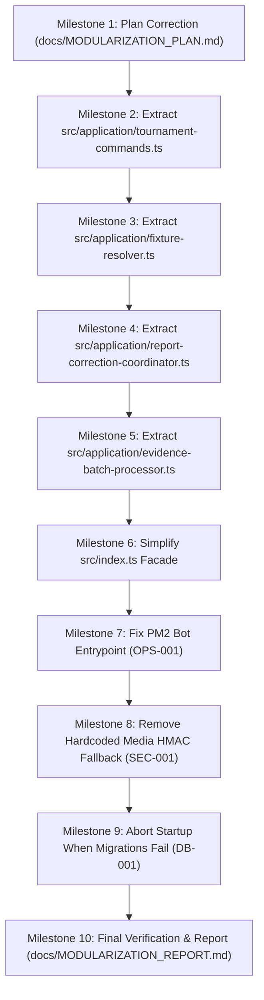

# Controlled Modularization Plan — Flash Peak TMS (Corrected)

**Document Version:** 1.1.0 (Corrected Architecture Review)  
**Date:** 18 November 2026  
**Status:** APPROVED FOR AUTONOMOUS EXECUTION  
**Author:** Senior Software Architect & Lead Integration Engineer  
**Reference Commit:** `50b43771da05748ed4272e5133586fc23bfb8805`  
**Starting HEAD Commit:** `92c3fa063f14b56c4a9e7b0be5c31d9f5989b54a`  
**Working Branch:** `refactor/modularize-turfpeak`  

---

## 1. Executive Summary

Flash Peak TMS is a WhatsApp-first Tournament Management System built in TypeScript (Node.js >= 20, ES Modules) backed by Turso/libSQL and Baileys. The system is authoritative: LLM providers (Gemini, Groq, Nvidia, Ollama) serve exclusively as evidence extractors and natural language interpreters, while all calculations, state transitions, validation rules, and standings updates are strictly enforced by backend code.

A baseline verification of the repository reveals that all 13 test suites (158 automated tests) pass and the TypeScript build (`tsc`) and ESLint pass cleanly with zero errors.

However, the repository exhibits significant architectural concentration in a single god-module: **`src/index.ts`** (1,518 lines). This file currently serves simultaneously as:
1. Application configuration factory and dependency injection container (`createApp`, `FlashPeakApp`).
2. Central tournament command registry and handler implementations (~490 lines for `!draw`, `!approve`, `!schedule`, `!createtournament`, `!addteam`, `!standings`, `!awards`, `!onboarding`).
3. Inbound message router, onboarding interceptor, and multi-tier fixture matcher (`resolveFixtureForMessage`, 146 lines).
4. Evidence batch processor pipeline (280 lines: media downloading, vision classification, match extraction, winner caption heuristics, left/right score swapping, deterministic validation, draft creation, WhatsApp formatting, and failure handling).
5. Report correction workflow orchestrator (100 lines: context assembly, natural language parsing, inbound message binding, patch execution, and response formatting).
6. Periodic debounce polling loop and outbound broadcast worker (`start()`, `stop()`).
7. Comprehensive barrel re-exporter for the entire repository.

### Architectural Boundary Review & Correction
During architectural review of v1.0.0, a key boundary flaw was identified:
- Placing command handlers into `src/competition/commands.ts`, batch processing into `src/ingestion/batch-processor.ts`, fixture matching into `src/ingestion/fixture-matcher.ts`, and correction coordination into `src/reports/coordinator.ts` conflated **application use-case orchestration** with **pure domain models**.
- Tournament command handlers coordinate competition, identity, onboarding, reports, statistics, WhatsApp, and database operations. They are application-layer workflows.
- Evidence batch processing coordinates ingestion, media retrieval, AI extraction, validation rules, report persistence, and WhatsApp messaging.
- Fixture resolution links incoming transport message context with delegate identity and tournament fixtures.
- Report correction coordination spans AI parsing, database message tracking, report versioning, and approval reset.

Therefore, the revised architecture introduces a dedicated **`src/application/`** layer for these 4 use-case coordinators while keeping `src/competition/`, `src/ingestion/`, and `src/reports/` pure, cohesive domain layers.

`src/index.ts` will be simplified from 1,518 lines to ~230 lines as a clean facade and composition root. This refactoring preserves 100% backwards compatibility with existing consumers (`src/cli/start.ts`, integration tests), preserves all public contracts, and introduces no breaking changes.

---

## 2. Current Architecture Assessment

### 2.1 Repository Layout and Domain Inventory
The application is structured into domain directories under `src/`:
- `src/whatsapp/`: Baileys socket connection wrapper (`connection.ts`), rate-limited sender (`sender.ts`), message normalizer (`normalizer.ts`), command router and authorizer (`router.ts`), response formatters (`formatters.ts`), failure messaging (`failure.ts`), and types (`types.ts`).
- `src/ai/`: Provider router with circuit breaker (`router.ts`), adapters for Gemini, Groq, Nvidia, Ollama, image classifier (`classifier.ts`), match extractor (`extractors/match.ts`), goalkeeper extractor (`extractors/goalkeeper.ts`), goalkeeper identity extractor (`extractors/gk-identity.ts`), correction parser (`correction-parser.ts`), and versioned prompts (`prompts/`).
- `src/competition/`: Tournament lifecycle (`tournament.ts`), cryptographic draw service (`draw.ts`), balanced round-robin fixture generator (`fixtures.ts`), group standings calculation (`standings.ts`), BO3/BO5 series progression (`series.ts`), and walkover/room-card handling (`walkover.ts`).
- `src/identity/`: Address resolution and alias tracking (`resolver.ts`) and interactive sequential onboarding state machine (`onboarding.ts`).
- `src/ingestion/`: Message capture (`capture.ts`), report session management (`session.ts`), and atomic 5-second sliding debounce leasing (`debounce.ts`).
- `src/reports/`: Immutable draft versioning (`versioning.ts`), backend deterministic validation (`validation.ts`), natural language patch application (`corrections.ts`), three-party consensus approval engine (`approval.ts`), authoritative player stats writeback (`stats.ts`), and administrative manual fallback (`manual.ts`).
- `src/stats/`: Cumulative statistics aggregator (`aggregator.ts`) and individual tournament awards calculation (`awards.ts`).
- `src/media/`: Flash Peak media service client adapter (`client.ts`).
- `src/db/`: libSQL database connection factory (`client.ts`) and migration runner (`migrate.ts`).
- `src/shared/`: Authoritative TypeScript type definitions (`types/index.ts`) and Zod validation schemas (`schemas/index.ts`).
- `services/flashpeak-media/`: Dedicated microservice implementing the Verax media storage pattern (isolated process on port 4189 with SQLite metadata sidecar and HMAC-SHA256 authentication).

### 2.2 Coupling, Cohesion, and Complexity Metrics
- **Circularity:** Audit verification using dependency cycle analysis confirmed **0 circular dependencies** in `src/`. The existing domain directories form a clean directed acyclic graph (DAG).
- **Complexity Concentration:** `src/index.ts` accounts for 1,518 of the codebase's ~10,400 total lines (~15% of all code). The second largest source file is `src/competition/walkover.ts` at 623 lines.
- **Violation of SRP:** `FlashPeakApp` mixes high-level application coordination with low-level SQL queries, regex string parsing, setTimeout pacing loops, and multi-step pipeline orchestration.

---

## 3. Dependency Graphs: Before and After

### Current Dependency Graph

```mermaid
graph TD
    CLI[src/cli/start.ts] --> App[src/index.ts]
    TestCmd[tests/integration/competition_commands.test.ts] --> App
    TestFlow[tests/integration/full_flow.test.ts] --> App

    subgraph "src/index.ts (Monolithic Orchestrator - 1,518 lines)"
        Config[App Config & Factory]
        Cmds[Command Handlers: !draw, !approve, etc.]
        Inbound[handleInboundMessage & Fixture Matcher]
        BatchProc[processDueDebounceBatches & processSingleClaimedBatch]
        CorrCoord[handleCorrection & Report Context]
        Poller[start / stop Interval Polling]
    end

    App --> DB[(libSQL / Turso)]
    App --> WA_Router[src/whatsapp/router.ts]
    App --> WA_Sender[src/whatsapp/sender.ts]
    App --> WA_Formatters[src/whatsapp/formatters.ts]
    App --> WA_Failure[src/whatsapp/failure.ts]
    App --> Ident_Res[src/identity/resolver.ts]
    App --> Ident_Onb[src/identity/onboarding.ts]
    App --> Media_Cli[src/media/client.ts]
    App --> Ing_Cap[src/ingestion/capture.ts]
    App --> Ing_Sess[src/ingestion/session.ts]
    App --> Ing_Deb[src/ingestion/debounce.ts]
    App --> AI_Router[src/ai/router.ts]
    App --> AI_Class[src/ai/classifier.ts]
    App --> AI_Match[src/ai/extractors/match.ts]
    App --> AI_GK[src/ai/extractors/goalkeeper.ts]
    App --> AI_Corr[src/ai/correction-parser.ts]
    App --> Rep_Ver[src/reports/versioning.ts]
    App --> Rep_Val[src/reports/validation.ts]
    App --> Rep_Corr[src/reports/corrections.ts]
    App --> Rep_Appr[src/reports/approval.ts]
    App --> Rep_Man[src/reports/manual.ts]
    App --> Comp_Tourn[src/competition/tournament.ts]
    App --> Comp_Draw[src/competition/draw.ts]
    App --> Comp_Fix[src/competition/fixtures.ts]
    App --> Comp_Stand[src/competition/standings.ts]
    App --> Stats_Awards[src/stats/awards.ts]
```


### Corrected Target Architecture Graph
```mermaid
graph TD
    CLI[src/cli/start.ts] --> Facade[src/index.ts (FlashPeakApp Facade)]
    Tests[tests/integration/*.test.ts] --> Facade

    subgraph "Application Layer (src/application/)"
        TournCmds[src/application/tournament-commands.ts]
        FixResolver[src/application/fixture-resolver.ts]
        BatchProc[src/application/evidence-batch-processor.ts]
        RepCoord[src/application/report-correction-coordinator.ts]
    end

    Facade --> TournCmds
    Facade --> FixResolver
    Facade --> BatchProc
    Facade --> RepCoord

    TournCmds --> CompDomain[src/competition/*]
    TournCmds --> WARouter[src/whatsapp/router.ts]
    TournCmds --> WAFormatters[src/whatsapp/formatters.ts]
    TournCmds --> IdentDomain[src/identity/*]
    TournCmds --> StatsDomain[src/stats/awards.ts]
    
    FixResolver --> DB[(libSQL / Turso)]
    FixResolver --> IdentResolver[src/identity/resolver.ts]
    
    BatchProc --> AIDomain[src/ai/*]
    BatchProc --> MediaCli[src/media/client.ts]
    BatchProc --> RepDomain[src/reports/*]
    BatchProc --> IngDomain[src/ingestion/debounce.ts]
    BatchProc --> WAFormatters
    BatchProc --> WAFailure[src/whatsapp/failure.ts]
    
    RepCoord --> AICorrParser[src/ai/correction-parser.ts]
    RepCoord --> RepDomain
    RepCoord --> IngCapture[src/ingestion/capture.ts]
    RepCoord --> IdentResolver
```

---

## 4. Problematic Modules & Architectural Risks

### 4.1 `src/index.ts`
- **Problem 1 (Inline Command Implementations):** 487 lines in `registerAppCommands()` implement complex workflow algorithms. For example, `!draw` performs cryptographic draw preparation, runs a sequential while-loop with 2500ms `setTimeout` pacing delays between team reveals, broadcasts formatted text messages over WhatsApp, triggers round-robin fixture generation, transitions tournament status, queries generated fixtures, and broadcasts fixture schedules.
- **Problem 2 (Fixture Resolution Heuristics):** 146 lines in `resolveFixtureForMessage` perform regex string matching to identify winning team names in captions, perform fallback lookups for verified delegates, and fall back to scheduled active fixtures.
- **Problem 3 (Evidence Batch Processing Pipeline):** 280 lines in `processSingleClaimedBatch` download media assets from the media client, classify screenshots, run match extraction, detect winner declarations to swap Team A/B scores and player stats, execute backend validation, create report draft records, format WhatsApp summaries, and handle AI outages.
- **Problem 4 (Correction Orchestration):** 100 lines in `handleCorrection` assemble report contexts from stored draft payloads, parse corrections via `CorrectionParser`, ensure inbound message persistence, apply patches, and format WhatsApp replies.
- **Problem 5 (Excessive Public Re-Exports):** Re-exports all submodules indiscriminately, blurring layer boundaries.

### 4.2 `src/cli/start.ts`
- **Security Issue (Hardcoded Fallback Secret):** Line 76 contains a hardcoded fallback HMAC secret (`'e56ad9530df7d79427f1e39d089210eddf18c55d136ca4a3cec438eff86dc206'`). *Flagged as an operational/security finding to be resolved in a dedicated commit.*
- **Deployment Divergence:** `ecosystem.config.cjs` specifies `args: 'src/index.ts'` for the `flashpeak-bot` process, whereas `package.json` specifies `"start": "tsx src/cli/start.ts"`. Executing `src/index.ts` directly via tsx exits immediately because `src/index.ts` does not contain a self-invoking runner. *To be resolved in a dedicated operational commit.*
- **Migration Error Handling:** `src/cli/start.ts` swallows migration errors with a console warning rather than aborting startup, which could lead to runtime errors if the database schema is outdated. *To be resolved in a dedicated operational commit.*

---

## 5. Corrected Target Architecture & Module Responsibilities

The target architecture introduces a clean application orchestration layer in **`src/application/`** consisting of **4 focused, highly cohesive modules**:

1. **`src/application/tournament-commands.ts`**: Owns the registration and execution logic for all tournament commands (`!standings`, `!awards`, `!schedule`/`!jadwal`, `!approve`, `!createtournament`, `!draw`, `!addteam`, `!onboarding`).
2. **`src/application/fixture-resolver.ts`**: Owns multi-tier fixture resolution (caption regex matching, sender identity auto-lock, and scheduled fixture fallback).
3. **`src/application/evidence-batch-processor.ts`**: Owns the claimed evidence batch processing pipeline (media download, classification, match extraction, caption winner detection & side-swap, validation, draft creation, and summary formatting).
4. **`src/application/report-correction-coordinator.ts`**: Owns natural language correction orchestration (context reconstruction, correction parsing, message persistence, patch application, and reply formatting).
5. **`src/index.ts` (Refactored Facade)**: Coordinates the subsystems, manages the background polling interval, and maintains 100% backwards-compatible public methods.

---

## 6. Module Responsibility Matrix

| Module | Primary Responsibility | Input Types | Output Types | Key Dependencies | Side Effects |
| :--- | :--- | :--- | :--- | :--- | :--- |
| **`src/application/tournament-commands.ts`** | Registers tournament management commands to `CommandRouter` and coordinates tournament workflows. | `CommandRouter`, `TournamentCommandDeps` | `void` | `draw.ts`, `fixtures.ts`, `tournament.ts`, `formatters.ts`, `awards.ts` | Database writes for draw, fixtures, tournament status, team inserts; WhatsApp progressive reveal messages. |
| **`src/application/fixture-resolver.ts`** | Resolves an active fixture for an incoming message via caption matching, delegate identity, or schedule. | `Client`, `IdentityResolver`, `NormalizedMessage` | `MatchedFixtureResult \| null` | `@libsql/client`, `IdentityResolver`, `NormalizedMessage` | Read-only database queries against `teams`, `fixtures`, `tournaments`. |
| **`src/application/evidence-batch-processor.ts`** | Processes a claimed debounce batch through media download, AI classification/extraction, validation, and draft creation. | `ClaimedBatch`, `EvidenceBatchProcessorDeps` | `ProcessedBatchResult` | `FlashPeakMediaClient`, `ImageClassifier`, `MatchSummaryExtractor`, `validateMatchReport`, `createReportDraft`, `completeDebounceBatch` | Updates `report_sessions` status; writes to `report_versions` and `report_media`. |
| **`src/application/report-correction-coordinator.ts`** | Reconstructs report context, parses natural language corrections, applies patches, and creates next draft version. | `Client`, `CorrectionParser`, `IdentityResolver`, `UUID`, `NormalizedMessage` | `{ result: CorrectionResult; replyText: string }` | `CorrectionParser`, `applyReportCorrection`, `getReportVersion`, `captureInboundMessage` | Writes new `report_versions` row; resets approvals; records inbound message. |
| **`src/index.ts`** | Top-level composition root, lifecycle manager (`start`/`stop`), and backwards-compatible public API facade. | `FlashPeakAppConfig` | `FlashPeakApp` instance | All extracted modules, `IdentityResolver`, `OnboardingService`, `CommandRouter` | Starts and stops polling timer; dispatches outbound WhatsApp notifications. |

---

## 7. Internal API Contracts

### 7.1 Tournament Commands Registration Contract (`src/application/tournament-commands.ts`)
```typescript
export interface TournamentCommandDeps {
  db: Client;
  identityResolver: IdentityResolver;
  onboardingService: OnboardingService;
  sender?: WhatsAppSender;
  getStandingsTable: (tournamentId: UUID, groupId: UUID, groupCode?: string) => Promise<string>;
  submitApproval: (
    reportVersionId: UUID,
    approverType: ApproverType,
    approverId: string,
    decision: ApprovalDecision,
    isOrganizer?: boolean
  ) => Promise<ApprovalOutcome>;
  findVersionByMessageKey: (messageKey: string) => Promise<ReportVersion | null>;
}

export function registerTournamentCommands(
  router: CommandRouter,
  deps: TournamentCommandDeps
): void;
```

### 7.2 Fixture Matching Contract (`src/application/fixture-resolver.ts`)
```typescript
export interface MatchedFixtureResult {
  id: UUID;
  team_a_id: UUID;
  submitting_team_id?: UUID;
}

export async function resolveFixtureForMessage(
  db: Client,
  identityResolver: IdentityResolver,
  message: NormalizedMessage
): Promise<MatchedFixtureResult | null>;
```

### 7.3 Evidence Batch Processor Contract (`src/application/evidence-batch-processor.ts`)
```typescript
export interface EvidenceBatchProcessorDeps {
  db: Client;
  mediaClient?: FlashPeakMediaClient;
  providerRouter?: ProviderRouter;
  classifier?: ImageClassifier;
  matchExtractor?: MatchSummaryExtractor;
  centralGroupJid?: string;
}

export async function processClaimedBatch(
  deps: EvidenceBatchProcessorDeps,
  batch: ClaimedBatch
): Promise<ProcessedBatchResult>;
```

### 7.4 Report Correction Coordinator Contract (`src/application/report-correction-coordinator.ts`)
```typescript
export interface ReportCorrectionCoordinatorDeps {
  db: Client;
  correctionParser: CorrectionParser;
  identityResolver: IdentityResolver;
}

export async function handleReportCorrection(
  deps: ReportCorrectionCoordinatorDeps,
  versionId: UUID,
  message: NormalizedMessage
): Promise<{ result: CorrectionResult; replyText: string }>;
```

---

## 8. Proposed File Structure

### 8.1 Files to Retain Unchanged
- All existing domain modules in `src/ai/` (14 files: classifier, router, adapters, extractors, prompts).
- All existing competition logic in `src/competition/` (`draw.ts`, `fixtures.ts`, `series.ts`, `standings.ts`, `tournament.ts`, `walkover.ts`).
- All existing identity modules in `src/identity/` (`resolver.ts`, `onboarding.ts`).
- All existing ingestion modules in `src/ingestion/` (`capture.ts`, `debounce.ts`, `session.ts`).
- All existing reports modules in `src/reports/` (`approval.ts`, `corrections.ts`, `manual.ts`, `stats.ts`, `validation.ts`, `versioning.ts`).
- All existing stats modules in `src/stats/` (`aggregator.ts`, `awards.ts`).
- All existing WhatsApp modules in `src/whatsapp/` (`connection.ts`, `failure.ts`, `formatters.ts`, `normalizer.ts`, `router.ts`, `sender.ts`, `types.ts`).
- `src/db/client.ts`, `src/db/migrate.ts`, `src/media/client.ts`.
- `src/shared/types/index.ts`, `src/shared/schemas/index.ts`.
- `services/flashpeak-media/*`.
- `tests/*`.

### 8.2 New Files to Create (4 application files)
1. `src/application/tournament-commands.ts` (~450 lines) — Tournament commands registration and use cases.
2. `src/application/fixture-resolver.ts` (~150 lines) — Fixture resolution logic.
3. `src/application/evidence-batch-processor.ts` (~280 lines) — Evidence batch processing pipeline.
4. `src/application/report-correction-coordinator.ts` (~100 lines) — Report correction coordination.

### 8.3 Files to Modify (3 files)
1. `src/index.ts`: Refactored to delegate to `src/application/*`. Reduced from 1,518 lines to ~230 lines while preserving all public exports.
2. `ecosystem.config.cjs`: Fix PM2 bot script args from `src/index.ts` to `src/cli/start.ts` (OPS-001).
3. `src/cli/start.ts`: Remove hardcoded media fallback secret (SEC-001) and abort startup on migration failure (DB-001).

---

## 9. Public API Compatibility Strategy

`src/index.ts` will continue to export every symbol that is currently exported. All existing external consumers (`src/cli/start.ts`, `tests/integration/competition_commands.test.ts`, `tests/integration/full_flow.test.ts`) will function without any import path modifications.

The following public interface of `FlashPeakApp` is 100% preserved:
```typescript
export class FlashPeakApp {
  public readonly db: Client;
  public readonly identityResolver: IdentityResolver;
  public readonly onboardingService: OnboardingService;
  public readonly commandRouter: CommandRouter;
  public readonly mediaClient?: FlashPeakMediaClient;
  public readonly providerRouter?: ProviderRouter;
  public readonly classifier?: ImageClassifier;
  public readonly matchExtractor?: MatchSummaryExtractor;
  public readonly gkExtractor?: GoalkeeperDetailExtractor;
  public readonly correctionParser?: CorrectionParser;
  public readonly centralGroupJid?: string;
  public sender?: WhatsAppSender;

  constructor(config: FlashPeakAppConfig);
  public setSender(sender: WhatsAppSender): void;
  public handleInboundMessage(message: NormalizedMessage, mediaBuffer?: Buffer | null): Promise<InboundHandlingResult>;
  public processDueDebounceBatches(): Promise<ProcessedBatchResult[]>;
  public handleCorrection(versionId: UUID, message: NormalizedMessage): Promise<{ result: CorrectionResult; replyText: string }>;
  public submitApproval(reportVersionId: UUID, approverType: ApproverType, approverId: string, decision: ApprovalDecision, isOrganizer?: boolean): Promise<ApprovalOutcome>;
  public submitManualReport(input: ManualReportInput): Promise<ManualReportResult>;
  public getStandingsTable(tournamentId: UUID, groupId: UUID, groupCode?: string): Promise<string>;
  public getAwardsSummary(tournamentId: UUID, tournamentTitle?: string, options?: AwardsCalculationOptions): Promise<{ awards: TournamentAwardsSummary; formattedText: string }>;
  public start(): void;
  public stop(): void;
}

export function createApp(config: FlashPeakAppConfig): FlashPeakApp;
```

---

## 10. Database and Side-Effect Boundaries

All database mutations and transaction semantics are strictly preserved:
1. **Debounce Batches:** Atomic claiming via optimistic version checks in `src/ingestion/debounce.ts` is unchanged.
2. **Draft Versioning:** Immutable append-only version creation (`v1`, `v2`) in `report_versions` is unchanged.
3. **Approval Lifecycle:** 3-party consensus requirements (Team A + Team B + Organizer) and post-lock side-effects (authoritative stats writeback, standings recalculation) are unchanged.
4. **Draw Service:** Cryptographically secure Fisher-Yates shuffle, pre-reveal persistence, and progressive reveal steps are unchanged.
5. **No Schema Changes:** Zero migrations or schema modifications are introduced.

---

## 11. Testing Strategy

### 11.1 Verification Baseline
The pre-refactoring baseline is established:
- `npm run build`: Exit 0 (0 compilation errors).
- `npm test`: 13 test files passed, 158 tests passed (0 failures).
- `npm run lint`: Exit 0 (0 warnings, 0 errors).

### 11.2 Checkpoint Verification Gates
After each incremental milestone:
1. Run `npm run build` to verify type safety and import integrity.
2. Run `npm test` to verify that all 158 tests pass without regression.
3. Run `npm run lint` to verify code quality standards.
4. Run `git diff --check` to ensure no whitespace or formatting anomalies.

---

## 12. Implementation Sequence & Git Milestones



1. **Commit 1:** `docs(refactor): correct modularization architecture plan`
2. **Commit 2:** `refactor(application): extract tournament command handlers`
3. **Commit 3:** `refactor(application): extract fixture resolution`
4. **Commit 4:** `refactor(application): extract report correction coordination`
5. **Commit 5:** `refactor(application): extract evidence batch processing`
6. **Commit 6:** `refactor(app): simplify application facade`
7. **Commit 7:** `fix(deploy): correct PM2 bot entrypoint`
8. **Commit 8:** `fix(security): remove hardcoded media HMAC fallback`
9. **Commit 9:** `fix(db): abort startup when migrations fail`
10. **Commit 10:** `docs(refactor): document final modularization results`

---

## 13. Estimated Source File Count & Lines of Code

| Metric | Before Refactoring | After Refactoring | Net Change |
| :--- | :--- | :--- | :--- |
| **Total Source Files in `src/`** | 60 files | 64 files | +4 files |
| **`src/index.ts` Line Count** | 1,518 lines | ~230 lines | -1,288 lines (~85% reduction) |
| **`src/application/tournament-commands.ts`** | 0 lines | ~450 lines | +450 lines |
| **`src/application/fixture-resolver.ts`** | 0 lines | ~150 lines | +150 lines |
| **`src/application/evidence-batch-processor.ts`** | 0 lines | ~280 lines | +280 lines |
| **`src/application/report-correction-coordinator.ts`** | 0 lines | ~100 lines | +100 lines |
| **Total Lines in `src/`** | ~10,400 lines | ~10,090 lines | Minimal net change (dead code reduction) |

---

## 14. Documented Discrepancies & Known Issues

1. **Goalkeeper Screenshot Count Conflict:**
   - `AGENTS.md` §8 states: *"One goalkeeper detail image per game actually played in a BO3/BO5 series is expected from the series-winning team's goalkeeper/delegate after the series ends."*
   - `flash-peak-tms/DECISIONS.md` O-001 clarifies: *"Screenshot count is one per game WON by the series-winning team's goalkeeper, not per game played. A BO3 2–1 submits 2 screenshots, not 3."*
   - *Policy:* Documented discrepancy recorded. No changes to goalkeeper behavior or tests will be made during modularization.
2. **Duplicate Instruction Files:**
   - `AGENT.md` and `AGENTS.md` at project root have identical SHA256 hashes (`932FF0C26B73C74FAD73DE585EF4056B83AF6F97F0AC3A47D3BB87905E32C22D`). Both files are retained.
3. **PM2 vs npm Entrypoint Divergence:**
   - `ecosystem.config.cjs` references `src/index.ts` as script args for PM2, while `package.json` references `src/cli/start.ts`. Addressed in Milestone 7 (`OPS-001`).
4. **Hardcoded Fallback Secret in `src/cli/start.ts`:**
   - Line 76 contains a hardcoded fallback HMAC secret. Addressed in Milestone 8 (`SEC-001`).
5. **Database Migration Error Handling:**
   - Migration failures in `src/cli/start.ts` are caught as warnings. Addressed in Milestone 9 (`DB-001`).
